# CDA Dust Analyzer Agent

## Overview

This project implements an end-to-end **multi-agent scientific discovery and classification system** for Cassini's Cosmic Dust Analyzer (CDA) Time-of-Flight (TOF) impact-ionization mass spectra, built on the **Google Agent Development Kit (ADK)** and **Vertex AI (`gemini-3.1-pro`, `gemini-3.5-flash`, and `gemini-4-argon`)**.

The unified [`cda_dust_agent/`](cda_dust_agent/) pipeline handles the complete scientific workflow:
1. **Literature-Grounded Multi-Agent Prompt Engineering**: A 3-agent loop (`AcademicResearchAgent` $\rightarrow$ `AcademicCriticAgent` $\rightarrow$ `AcademicRefereeAgent`) extracts physical constraints from published CDA literature and falsifies candidate rules against recall and false-positive hazards.
2. **Contrastive Few-Shot Annotation & Autonomous Consolidation**: Generates contrastive natural-language descriptions against reference examples of all classes and consolidates them hierarchically into canonical class morphologies.
3. **Cost-Bounded Stage-1 Survey Inference**: Screens obvious noise in Python (`is_obvious_noise`, bypassing `23%`–`65%` of spectra with `0%` false negatives) before dispatching surviving spectra via synchronous **Local Inference** or distributed **Cloud Dataflow + Vertex AI Batch Prediction** (`86%`–`91%` implicit context-cache hit rate).
4. **Stage-2 Mass-Calibrated Neuro-Symbolic & Specialist VLM Adjudication**: Routes rare salt-rich Type 3 candidates (**`3-OH`** sodium hydroxide and **`3-P`** sodium orthophosphate) through `Stage2SpecialistAdjudicatorAgent`, which performs physics-constrained two-anchor mass calibration $(\hat{t}_0, \hat{a})$ on $\text{Na}^+$ ($23.0\text{ u}$) and $\text{Na}^+(\text{NaOH})$ ($63.0\text{ u}$), renders dual-panel mass-calibrated plots ($10\text{--}200\text{ u}$ full + $70\text{--}195\text{ u}$ zoomed anion diagnostic window), and combines 1D mass-window physics vetoes with a leak-free blind specialist VLM (`gemini-4-argon`).

---

## Agent Details

| Feature | Description |
| --- | --- |
| **Interaction Type:** | Headless Workflow, Distributed Cloud Dataflow Prep & Vertex AI Batch |
| **Complexity:**  | Advanced (Two-Stage Neuro-Symbolic + Multi-Agent VLM) |
| **Agent Type:**  | Multi-Agent Orchestrator (`CdaWorkflowAgent`) |
| **Components:**  | ADK Core Tools, 3-Agent Academic Prompt Refinery, Contrastive Few-Shot Caching, Stage-1 Noise Pre-Filter, Two-Anchor Mass Calibration, Stage-2 Specialist VLM & 1D Physics Veto Adjudicator |

### Architecture

```mermaid
flowchart TD
    subgraph "CdaWorkflowAgent (Two-Stage Neuro-Symbolic & VLM Pipeline)"
        DataFetchAndParse([DataFetchAndParse]) --> PromptOptimizer([PromptOptimizer: Research → Critic → Referee])
        PromptOptimizer --> FewShotAnnotation([FewShotAnnotation & Contrastive Cache])
        
        FewShotAnnotation --> Cond{Inference Path?}
        
        Cond -- "local" --> LocalInference([LocalInference])
        Cond -- "batch" --> DataPrep([DataPrep + Stage-1 Noise Pre-Filter])
        
        DataPrep -- "Bypassed Noise (23%–65%)" --> ResultAnalysis([ResultAnalysis & Stage-1 Merge])
        DataPrep -- "Candidate Spectra" --> BatchSubmission([BatchSubmission: Gemini VLM])
        BatchSubmission --> BatchPolling([BatchPolling])
        
        LocalInference --> ResultAnalysis
        BatchPolling --> ResultAnalysis
        
        ResultAnalysis --> Stage2Adjudicator([Stage2SpecialistAdjudicator: 2-Anchor m/z Calibration + Dual-Panel Plot + 1D Physics Veto & Specialist VLM])
        Stage2Adjudicator --> VertexAIExperimentsLogging([VertexAIExperimentsLogging])
    end
```



---

## Headline Scientific Findings & Benchmarks

### 1. Multiclass 8-Class Survey (`Noise`, `1`, `2`, `3`, `4`, `5`, `5-Na`, `3-P`)
- On the **2,000-sample benchmark** ([`agent/reports/multi_agent_academic_analysis.md`](agent/reports/multi_agent_academic_analysis.md)), the multi-agent academic prompt synthesis + Stage-1 noise pre-filter ([`cda_dust_agent/stage_1_prefilter_methodology.md`](cda_dust_agent/stage_1_prefilter_methodology.md)) achieved **`87.19%` overall accuracy (`87.57%` weighted F1)**, with **`96.69%` precision on `Class 1` (Water Ice)**, **`93.55%` precision / `99.16%` recall on `Noise`**, and **`80.56%` precision / `76.32%` recall on `Class 4` (Silicate Nanodust)**.

### 2. Binary `3-OH` Discovery & Stage-2 Neuro-Symbolic Adjudication ([Full Methodology](cda_dust_agent/stage_2_adjudicator_methodology.md))
- **Model Upgrade (`gemini-3.5-flash` $\rightarrow$ `gemini-4-argon`)**:
  - **HITL Prompt (`707` study spectra)**: Accuracy rose from **`83.95%` $\rightarrow$ `87.41%`**, `3-OH` Recall from **`90.24%` $\rightarrow$ `92.68%` (`38/41`)**, and false positives dropped from `108` $\rightarrow$ `84`.
  - **AI-Only Literature Prompt (`698` study spectra)**: Accuracy rose from **`93.84%` $\rightarrow$ `95.99%`**, `3-OH` Precision jumped from **`48.75%` $\rightarrow$ `60.32%`**, and false positives fell by **39%** (`41` $\rightarrow$ `25`).
- **Anchored 3-Agent Prompt Optimization (Stage-1 on `698` study spectra)**:
  - Synthesized a 5-gate diagnostic prompt ([`cda_dust_agent/data/results/academic_referee_decision.md`](cda_dust_agent/data/results/academic_referee_decision.md)), achieving **`96.42%` accuracy**, **`63.79%` precision (`37` TP, `21` FP)**, **`90.24%` recall (`37/41`)**, and **`0.7475` F1**, with **0 false positives** across `Type 1`, `Type 2`, `3-Cl`, `3-K`, `3-P`, `4`, `5`, `5-Na`, and `Noise`.
- **Full `18,305`-Spectrum Labelled Archive Evaluation (Stage-1 $\rightarrow$ Stage-2 Progression)**:
  - **Stage-1 Pre-Filter**: Safely bypassed **`4,202` spectra (`22.95%`)** as obvious noise with **`0` true `3-OH` lost**, and achieved an **87.0% Vertex AI implicit cache hit rate** (`$112.49` total batch cost for `18,305` spectra).
  - **Stage-2 Two-Anchor Mass Calibration & Neuro-Symbolic Adjudication** ([`metrics_3oh_stage2_comparison.json`](cda_dust_agent/data/results/metrics_3oh_stage2_comparison.json)): Solved per-spectrum $(\hat{t}_0, \hat{a})$ from $\text{Na}^+$ ($23.0\text{ u}$) and $\text{Na}^+(\text{NaOH})$ ($63.0\text{ u}$) to resolve the $129\text{ u}$ carbonate (`3-Car`) vs. $143\text{ u}$ hydroxide degeneracy:

| Pipeline Stage (`18,305` Labelled Archive, `41` True `3-OH`) | Overall Accuracy | `3-OH` Recall | `3-OH` Precision | `3-OH` F1 | Total FPs (`/ 18,264`) | `3-Car` FPs (`/ 87`) |
| :--- | :---: | :---: | :---: | :---: | :---: | :---: |
| **Stage-1 VLM Only (`gemini-4-argon` + Referee Prompt)** | `99.83%` | **`90.24%` (`37/41`)** | `57.81%` | `0.7048` | `27` | `21` |
| **Stage-1 + Stage-2 Specialist VLM Only (Dual-Panel Mass Plot)** | `99.86%` | **`90.24%` (`37/41`)** | `62.71%` | `0.7400` | `22` | `16` |
| **Stage-1 + Hybrid Neuro-Symbolic Stage-2 (`passes_129_veto`)** | `99.93%` | **`85.37%` (`35/41`)** | **`85.37%` (`+27.6 pp`)** | **`0.8537`** | **`6` (`-77.8%`)** | **`5` (`-76.2%`)** |
| **Stage-1 + Strict Neuro-Symbolic Stage-2 (`passes_strict_veto`)** | **`99.94%`** | `80.49%` (`33/41`) | **`91.67%` (`+33.9 pp`)** | **`0.8571`** | **`3` (`-88.9%`)** | **`3` (`-85.7%`)** |

- **Unlabelled `24,829`-Spectrum Archive Discovery (`282` Stage-1 Union Candidates — [`unlabelled_3oh_stage2_summary.json`](cda_dust_agent/data/results/unlabelled_3oh_stage2_summary.json))**:
  - Stratified into **75 Tier-1** (Multi-Model Consensus $\ge 2$ + Physics & Stage-2 VLM Confirmed), **18 Tier-2** (Single-Model + Physics & Stage-2 VLM Confirmed, yielding **`93` hybrid-confirmed ultra-pure `3-OH` candidates**), **72 Tier-3** (Borderline: Passed Either Physics Gate or Stage-2 VLM Only), and **117 Tier-4** (Rejected by Both $129\text{ u}$ Physics Veto & Stage-2 VLM).

### 3. Leak-Free Blind `3-P` Stage-2 Audit (`377` Stage-1 Batch FPs from $N=17,146$ Archive)
- In the `17,146`-spectrum multiclass batch run (`cda-batch-20260707`), Stage-1 raw-TOF VLM achieved **`100.0%` recall** on rare `3-P` phosphate grains (`5/5` in the batch benchmark; `8/8` held-out catalogued `3-P` + mixed chloride-phosphate discovery `SCLK 1511735208`), but produced **`377` false positives (`1.31%` batch precision)** due to `3-Car` ($129\text{ u}$ vs. $125\text{ u}$), `3-Cl`, and elevated-baseline look-alikes ([`study_results_multi_agent/batch_20260707_academic_critic_report.md`](study_results_multi_agent/batch_20260707_academic_critic_report.md)).
- Applying the **Two-Tier Leak-Free Stage-2 `3-P` Architecture** ([`metrics_3p_stage2_comparison.json`](cda_dust_agent/data/results/metrics_3p_stage2_comparison.json), [`blind_3p_stage2_audit.csv`](cda_dust_agent/data/results/blind_3p_stage2_audit.csv)):
  - **1D 7-Parameter Bounding Box (Strict Leave-One-Out CV)**: Achieves **`80.0%` (`8/10`) LOOCV recall** on catalogued `3-P` (`72.7%` [`8/11`] when out-of-distribution mixed grain `SCLK 1511735208` with `p81 = 0.292` is included) and cuts Stage-1 batch FPs by **98.1%** (`377` $\rightarrow$ `7`).
  - **Tier-2 Loose Parameter-Free Physical Sign Screen (`diff_125_129 >= 0` & Triplet $\ge 0.04$)**: Retains **`100.0%` (`8/8` catalogued AND `9/9` including mixed-phase `SCLK 1511735208`)** while rejecting **`83.8%` (`316/377`)** of Stage-1 FPs (`93.1%` [`351/377`] rejected with `p81 <= 0.30`).
  - **Tier-1 Blind Stage-2 Specialist VLM (`gemini-4-argon`, Zero Threshold Leakage)**: Inspects only the dual-panel mass-calibrated figure and raw peak heights without pre-computed pass/fail flags—rejecting **`100.0%` (`377 / 377`) of Stage-1 batch false positives (`0` FPs across `17,146` spectra)** while retaining **`100.0%` (`8/8`) of held-out canonical catalogued `3-P` grains** (**`100.0%` [`5/5`] full-batch precision, `F1 = 1.00`**) and classifying the chloride-dominated mixed grain `SCLK 1511735208` as `3-Cl` (`8/9 = 88.9%` total recall).

---

## Agent Setup and Installation

### Prerequisites

*   **Google Cloud Account:** Configured access to the Vertex AI API (`gemini-3.1-pro`, `gemini-3.5-flash`, `gemini-4-argon`). You must have Application Default Credentials configured.
*   **Python 3.10+:** Ensure you have Python 3.10 or a later version installed.
*   **uv:** Install the Astral `uv` package manager: [https://docs.astral.sh/uv/getting-started/installation/](https://docs.astral.sh/uv/getting-started/installation/)

### Project Initialization

This agent uses `uv` to manage the environment and dependencies. When you initiate an ADK command using `uv run`, dependencies defined in `pyproject.toml` are synced and invoked automatically.

## Running the Agent

### Configuration

Workflow execution is controlled via [`cda_dust_agent/config.py`](cda_dust_agent/config.py) (which can also be overridden via `.env`):
- `inference_path`: Set to `"local"` or `"batch"`.
- `model` / `stage2_model`: Primary Stage-1 model (`"gemini-3.5-flash"` / `"gemini-4-argon"`) and Stage-2 specialist adjudicator model (`"gemini-4-argon"`).
- `enable_stage2_adjudicator`: Set to `True` to run `Stage2SpecialistAdjudicatorAgent` on positive Stage-1 candidates.
- `fetch_data`: Set to `True` to force re-downloading and parsing data from HuggingFace.
- `test_mode`, `few_shot_n`, `test_n`: Controls sampling quantities for local validation.
- `force_new_annotations`: Set to `True` to bypass the cached `.jsonl` and force a new Gemini few-shot visual annotation step.

### CLI Interaction

#### Interactive Mode
```bash
# Sync dependencies and run the agent interactively
uv run adk run cda_dust_agent
```

#### Non-Interactive Mode (Pure Workflow)
```bash
echo "run analysis" | uv run adk run cda_dust_agent
```

### ADK Web Interface
```bash
# Host the UI development server at http://127.0.0.1:8000
uv run adk web
```

---

## Folder Structure

- [`cda_dust_agent/`](cda_dust_agent/): Contains the unified ADK agent components (`CdaWorkflowAgent`).
  - `agent.py`: Defines the root agent (`CdaWorkflowAgent`) that ADK expects.
  - `sub_agent/`: Contains the Stage-1 and Stage-2 sub-agents (`workflow.py`, `specialist_adjudicator.py`, `data_prep.py`, `result_analysis.py`, etc.).
  - `config.py`: Configuration settings using Pydantic, pulling from environment variables.
  - `prompts.py`: Houses the Stage-1 multiclass and Stage-2 `3-OH` / `3-P` specialist adjudicator prompts.
  - `tools/`: Supportive utilities including `utils.py` (two-anchor mass calibration `calibrate_spectrum_mass_domain`, dual-panel mass plotter `generate_dual_panel_mass_spectrum_bytes`, 1D telemetry & physics vetoes `extract_mass_telemetry_3oh` / `extract_mass_telemetry_3p`, and Stage-1 noise pre-filters) and `prompt_refinery.py`.
  - `stage_1_prefilter_methodology.md` & `stage_2_adjudicator_methodology.md`: Detailed mathematical and experimental documentation for Stage 1 and Stage 2.
  - `data/`: Contains project data organized by pipeline stages (`raw/`, `input/`, `output/`, `results/`).
- [`agent/`](agent/) & [`study_results_multi_agent/`](study_results_multi_agent/): Evaluation scripts, Vertex AI experiment loggers, and multi-agent failure analysis reports.
- [`Notebooks/`](Notebooks/): Experimental ablation notebooks (`00`–`11`), `3-OH` study & unlabelled archive inference notebooks ([`Notebooks/3oh_classification/`](Notebooks/3oh_classification/)), and [`Notebooks/best_results_summary.md`](Notebooks/best_results_summary.md).
- [`scripts/`](scripts/): Batch orchestration, failure analysis, and evaluation utilities.
